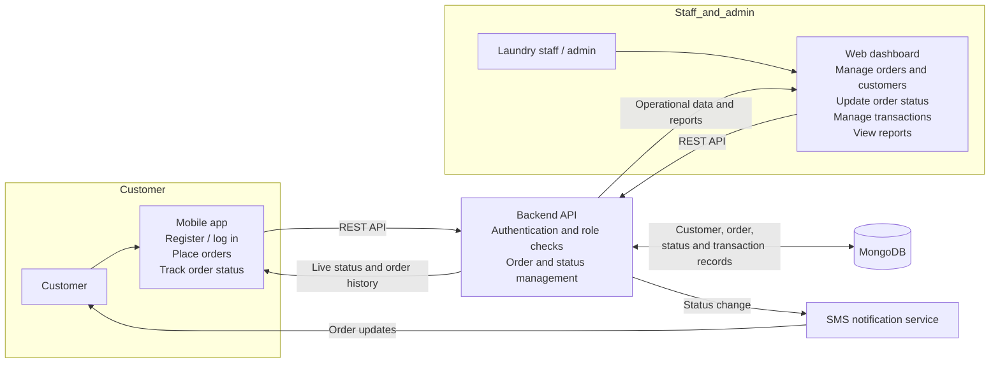

# 🧺 EcoShine Platform  
### 🚀 Secure & Scalable Full-Stack Laundry Management System

The **EcoShine Platform** is a modern, secure, and performance-optimized full-stack system designed to digitize and streamline laundry operations.

It supports:

- 🧼 Full-Service Laundry Management  
- 🧺 Self-Service Machine Reservation  
- 🎟️ Smart Token & Queue Management  
- 📱 Customer Mobile Application  
- 🖥️ Admin & Staff Web Dashboard  

Built using the **MERN Stack (TypeScript) + React Native**, this system strongly focuses on:

- 🔐 Security Best Practices  
- ⚡ Performance Optimization & Cache Handling  
- 🏗️ Clean Modular Architecture  
- 📊 Operational Monitoring & Analytics  

---

## 🛠️ Technology Stack

| Layer | Technology |
|-------|------------|
| 🌐 Web App | React + Vite + Tailwind CSS (TypeScript) |
| 📱 Mobile App | React Native + Expo |
| 🧠 Backend | Node.js + Express (TypeScript) |
| 🗄️ Database | MongoDB + Mongoose |
| 🔐 Authentication | JWT (Access + Refresh Tokens) |
| ⚡ Caching | Redis & In-Memory Cache |
| 🔄 Background Jobs | Node Cron |
| 📦 Version Control | Git & GitHub |
| 🧪 API Testing | Postman |

---

## 🏗️ System Architecture

Customers register or log in through the Expo mobile app, place laundry orders, and track progress. The Express API authenticates requests and applies role checks before reading or updating customer, order, status, and transaction records in MongoDB. Staff and administrators use the web dashboard to process orders, manage customers and transactions, and view reports. When staff update an order status, the API saves the change, makes it available to both apps, and triggers an SMS update to the customer.

### Shared Accounts and Database

The web dashboard and mobile app use the same Express API and MongoDB database. Configure the database with `MONGODB_URI` in `backend/.env` (the legacy `MONGO_URI` name is also supported); set `EXPO_PUBLIC_API_BASE_URL` in `mobile-app/.env` to the reachable backend URL (for a physical phone, use the computer's LAN IP rather than `localhost`). Public registration creates customer accounts only. Owners and staff sign in with accounts provisioned by an administrator; the web dashboard is for owners and staff, while mobile login supports both owner/staff and customer accounts.

The web customer portal provides separate customer sign-in and registration pages. The owner registration page creates only the initial owner account; further public owner registrations are rejected. Registration accepts Philippine mobile numbers (`09XXXXXXXXX` or `+639XXXXXXXXX`) and Sri Lankan mobile numbers (`07XXXXXXXX` or `+947XXXXXXXX`).

---

## ✨ Core Functionalities

### 🧼 Full-Service Laundry
- Service selection (Wash, Dry, Iron, Dry Clean)
- Order scheduling
- Status tracking (Received → Processing → Ready → Completed)
- Invoice generation

### 🧺 Self-Service Laundry
- Machine availability tracking
- Time-slot reservation
- Smart queue allocation
- Token generation

### 💳 Payment & Billing
- Online payment ready structure
- Order-based billing
- Payment status tracking
- Invoice history

### ⭐ Feedback System
- Customer rating submission
- Service performance monitoring
- Average rating analytics

---

## 🔐 Security Architecture

Security is a **core priority** in this system.

### 🔑 Authentication & Authorization
- JWT Access & Refresh Token mechanism
- Role-Based Access Control (RBAC)
- Protected API routes
- Token expiration handling
- Secure logout mechanism

### 🔒 Password & Data Security
- Password hashing using bcrypt
- Environment variable protection (.env)
- Sensitive data encryption ready
- Secure HTTP headers (Helmet)
- CORS policy configuration

### 🛡️ API Protection
- Request validation middleware
- Rate limiting
- Input sanitization
- Centralized error handling
- Protection against:
  - SQL/NoSQL Injection
  - XSS
  - CSRF
  - Token replay attacks

### 📱 Secure Mobile Handling
- Secure token storage
- No sensitive data in local storage
- Auto logout on token expiration

---

## ⚡ Cache Handling & Performance Optimization

The system is designed for high performance and scalability.

### 🚀 Caching Strategy
- Redis caching for:
  - Branch data
  - Service list
  - Frequently accessed configurations
- In-memory caching fallback
- Cache invalidation on update operations

### 📊 Performance Optimizations
- Indexed MongoDB queries
- Pagination implementation
- Lean queries for read operations
- Async processing for heavy operations
- Background cron jobs for cleanup

---

## 🧪 Testing & Quality Assurance

- Unit Testing
- Integration Testing
- Manual UI Testing
- Input validation testing
- Security scenario testing
- Error handling validation

---

## 📈 Project Management Approach

This project follows **Agile methodology**:

- Sprint Planning
- Task Breakdown (WBS)
- Risk Identification & Mitigation
- Kanban Board Tracking
- Progress Demonstrations
- Continuous Feedback Integration

---

## 🚀 Future Enhancements

- 🔔 Push Notifications
- 📩 Email Integration
- 💰 Payment Gateway Integration
- 🎁 Loyalty & Rewards System
- 🌍 Multi-Branch Franchise Expansion

---

## 📌 Key Highlights

✔ Secure JWT Authentication  
✔ Role-Based Access Control  
✔ Scalable Modular Architecture  
✔ Cache Optimization Strategy  
✔ Clean UI/UX Design  
✔ Mobile + Web Integration  

---
# sir_vernon
